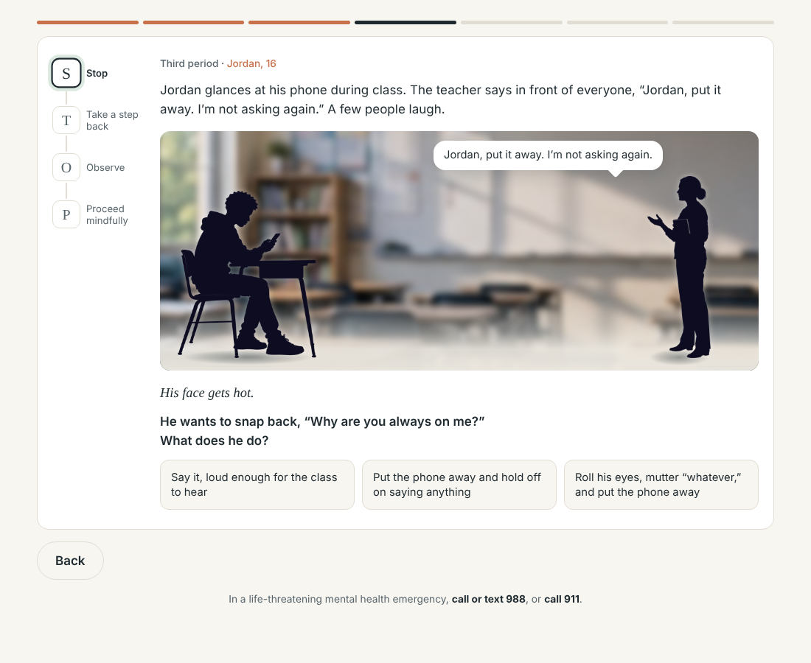
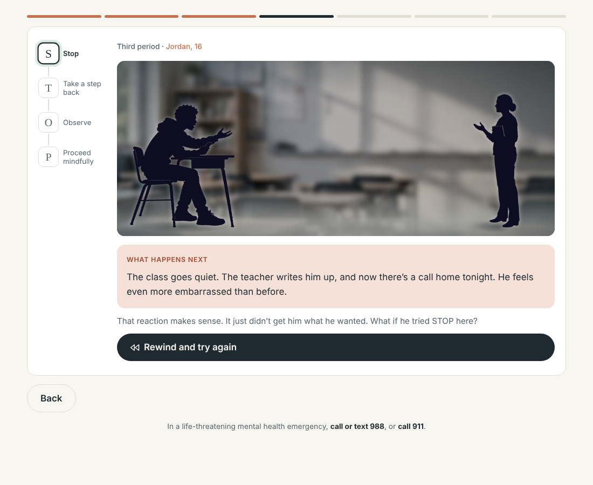

# Hit Pause: STOP Practice

A branching, choose-your-path practice module that helps teens rehearse the **STOP** skill (Stop, Take a step back, Observe, Proceed mindfully) between group sessions.

**[▶ Try it live](https://courtniegalindo19-lgtm.github.io/hit-pause-stop-practice/)**

Designed and built end to end by **Courtnie Galindo**, instructional designer and learning engineer.



---

## The learning problem

Learners can usually *recite* a coping skill after a session. The hard part is using it in the moment, when emotions are high and the urge to react is strong. Reading about the skill again doesn't build that habit. Practicing the decision does.

**Goal:** give learners a low-stakes way to rehearse the exact moment when STOP matters, see what happens when they skip it, and leave with a personal plan for their own trigger.

**Audience:** teens (roughly 14–17) who learned STOP in a group setting and need between-session practice.

## Learning objectives

By the end of the module, learners can:

1. Name the four steps of STOP and what each one looks like in practice.
2. Choose a STOP-aligned response in a realistic, emotionally charged scenario.
3. Tell the difference between a **fact** (what a camera could record) and a **story** (what the mind adds).
4. Build a personal STOP plan for a situation that tends to set them off.

## How it works

| Screen | What the learner does | Why |
|---|---|---|
| **Title** | Sees the time commitment and a privacy note | Sets expectations and makes it feel safe to be honest |
| **Refresher** | Recalls each letter, then flips a card to check | Retrieval practice before application |
| **Pick a situation** | Chooses school, home, or online gaming | Relevance and learner choice |
| **Branching story** | Picks a reaction at each STOP step and sees it play out | Consequences teach more than being told the answer |
| **Fact or story?** | Sorts thoughts into facts vs. stories | Deliberate practice on Observe, the hardest step |
| **Notice, right now** | Works through self-paced grounding prompts | Moves from helping a character to practicing personally |
| **Build your STOP card** | Taps through a personal plan for their own trigger | Transfer to real life with a takeaway they can save |
| **Wrap-up** | Rates readiness and gets tailored encouragement | Self-assessment and a bridge back to group |



## Key design decisions

**Safe failure, not right answers.** Each step offers a reactive choice, a "somewhat better" choice, and a STOP-aligned choice. Reactive choices play out with realistic consequences instead of a red "wrong" message. The feedback validates the reaction ("That reaction makes sense") before inviting a different approach.

**Rewind instead of retry.** A rewind button returns learners to the decision point with a short animation. It frames trying again as exploring rather than failing, and the ending reflects on it: *in real life there's no rewind button, so STOP is how you pause first.*

**Three tiers of outcomes.** Middle options ("That helped a little") show that avoidance and half-measures aren't failures but don't fully meet the character's goal. That's more honest and more useful than a binary right/wrong.

**Focus on Observe.** Separating facts from stories is the most abstract step, so it gets its own interactive sorting task and a camera test learners can reuse anywhere: *if a camera could record it, it's a fact.*

**Realistic, relatable scenarios.** Getting called out in class, a tense dinner conversation, and a toxic in-game chat. The feelings are named in body terms ("His face gets hot") to model noticing physical cues.

**A takeaway that transfers.** The STOP card turns the practice into a personal plan, with starter options so nobody faces a blank box and a "write my own" option for anyone who wants it.

## Accessibility and inclusion

- Keyboard-operable throughout, with visible focus states
- `aria-live` regions announce feedback, and the progress rail uses `aria-current`
- Respects `prefers-reduced-motion`: parallax, card flips, breathing animation, and rewind effects all turn off
- Light and dark themes based on the system setting
- Responsive from phone width up, with layouts that reflow rather than shrink
- Plain-language copy and short screens to reduce cognitive load
- No data collection: nothing typed is stored or sent anywhere
- Crisis resources (988 / 911) visible on every screen

## Built with

- Vanilla HTML, CSS, and JavaScript in a single file, with no framework and no build step
- A small branching-scenario engine: each scenario is a data object of nodes (choice, outcome, observe, end), so new scenarios can be added without touching the logic
- A layered "stage": background, characters, and props move at different depths for subtle parallax, and characters swap poses to match the emotional beat
- CSS custom properties for theming

## Run it locally

No install needed. Clone the repo and open `index.html` in a browser, or serve the folder:

```bash
npx serve .
```

## What I'd do next

- Add audio narration with word-level highlighting for younger or struggling readers
- Track (privately, on-device) which scenarios a learner has completed across sessions
- Build an authoring view so facilitators can write their own scenarios in the same format
- Usability-test with teen learners and revise the option wording based on what they actually pick

---

*This is an original portfolio project. It's a practice tool, not therapy or a substitute for professional care.*

© 2026 Courtnie Galindo. All rights reserved.
